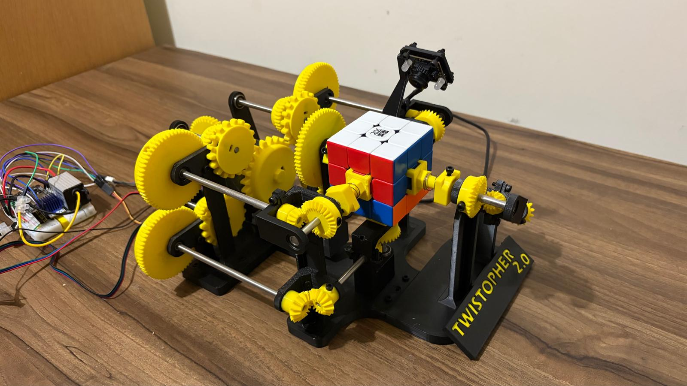

# Twistopher-2-Single-Motor-Cube-Solver
### A single-motor Rubik's Cube-solving robot that never reorients the cube. Not built for speed or to break any records, but to simply see how absurdly complicated a solution can get when you add unnecessary (but creatively challenging) constraints.

**One motor. No cube reorientation. A completely unnecessary amount of mechanical complexity.**

**▼ Click the image below to watch Twistopher II autonomously scan and solve a scrambled Rubik's Cube.**

---

## Overview

Twistopher II is a custom-designed Rubik's Cube-solving robot built around two unusual constraints: it must operate using a single motor, and it must never reorient the cube.

Unlike conventional Rubik's Cube-solving robots, Twistopher II was never intended to break speed records or maximise efficiency.

Instead, the project explores how absurdly complicated a solution can become when you impose unnecessary yet creatively inspiring constraints.

These restrictions offer no inherent practical advantage. In fact, they make the engineering challenge considerably harder. But that's precisely the point.

The result is an unconventional electromechanical design that prioritises mechanical ingenuity, creative problem-solving and experimentation over outright performance.

---

## Design Constraints

The project was developed around two fundamental restrictions:

**1. Single-motor operation**

All mechanically driven cube manipulation must be achieved using only one motor.

**2. No cube reorientation**

The cube must remain in its original orientation throughout the solving process.

Together, these constraints create a mechanical design challenge that is very different from simply building the fastest possible cube-solving robot.

---

## Mechanical Design and CAD

*[Insert full CAD assembly render]*

The mechanical design is a central focus of Twistopher II.

This section documents the development of the mechanisms, the CAD modelling process, the design iterations and the manufacturing of the physical components.

- **CAD software:** [To be added]
- **Manufacturing methods:** [To be added]
- **Key mechanisms:** [To be added]

### Design Development

*[Insert CAD screenshots, mechanism diagrams and design iterations]*

---

## Electronics and Control

*[Insert electronics photograph or wiring diagram]*

This section describes the electronic components, motor-control system and integration between the controller and the mechanical assembly.

- **Microcontroller:** [To be added]
- **Motor and driver:** [To be added]
- **Additional electronics:** [To be added]

---

## Software

This section covers the software used to control the robot, coordinate mechanical operations and implement the cube-solving process.

- **Programming languages:** [To be added]
- **Control architecture:** [To be added]

Source code will be provided in this repository.

---

## Build and Demonstration

*[Insert photographs of the physical assembly]*

**Demonstration video:** [Link to be added]

This section will document the assembly process, testing, performance and remaining limitations.

---

## Project Files

- CAD models and assemblies
- 3D-printing files
- Electronic control code
- Wiring documentation
- Build photographs and demonstrations

---

## Future Development

[Planned improvements and remaining challenges to be added.]

---

*Twistopher II is a personal engineering project exploring what happens when mechanical creativity takes priority over practical efficiency.*
